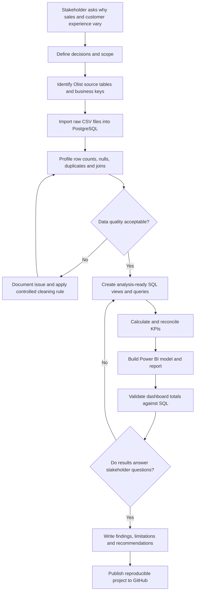

# Business Analysis Process Flow: Project 1

## Business Analyst explanation

The process separates the business need from the solution. Requirements are agreed before dashboard design; data quality is checked before metrics are calculated; and dashboard figures are reconciled to SQL before recommendations are presented. This reduces the risk of building a polished report around incorrect numbers.
